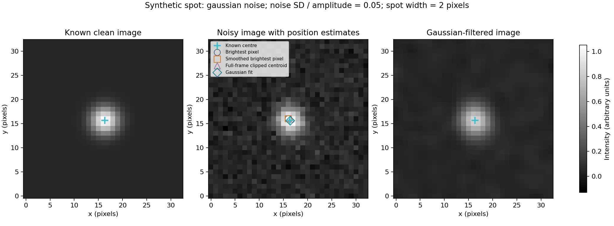

# Locating atoms in noisy images

A complete Python project comparing four ways of measuring the position of a synthetic bright spot: brightest pixel, smoothed brightest pixel, a full-frame clipped centroid and a Gaussian fit.

The experiment checks estimates against known centres across repeated noise realisations, spot widths and positions. It saves every trial, summary statistics, labelled figures and a results report. The signal is a simplified Gaussian, not a full electron-microscopy simulation.



See the [example results report](examples/report.md) for a run using 7,200 simulated images, or read the [mathematical walkthrough](docs/explanation.md).

## Project versions

- `codex/complete-project` contains the complete implementation and is the public repository's default branch.
- A separate `codex/learning` branch preserves the initial guided exercises locally. It is not published to this repository.

The original local setup uses two Git worktrees so that both branches can remain open at once. In that setup the learning folder contains the complete worktree at `.worktrees/complete-project`; check the branch in either terminal with `git branch --show-current`. Each folder already has its own branch.

## Run the project

Clone the repository, then create an environment and install the dependencies. These commands are for a macOS or Linux terminal:

```sh
git clone https://github.com/SchwiftySnail/atom-localisation.git
cd atom-localisation
python3 -m venv .venv
source .venv/bin/activate
python -m pip install -r requirements-dev.txt
python run_project.py
```

If the project is already open locally, run `python3 run_project.py` from the complete project's folder. Terminal commands belong in the terminal, not inside a Python file.

The default run uses 100 trials for each of 45 conditions: three spot widths, three positions and five Gaussian noise levels. That produces 4,500 images and 18,000 method results. It writes to `outputs/experiment/` relative to the terminal's current folder.

Open `outputs/experiment/report.md` for the results. In Cursor, open the Markdown preview to view its figures. There is no separate plot window.

For a quick first run in a separate output folder:

```sh
python3 run_project.py --trials 10 --sigmas 2 --noise-levels 0 0.1 --output outputs/quick
```

For both Gaussian and Poisson noise:

```sh
python3 run_project.py --noise-models gaussian poisson --output outputs/both-noise-models
```

For a larger run after you understand the smaller one:

```sh
python3 run_project.py --trials 500 --seed 2027 --output outputs/larger-run
```

Use `python3 run_project.py --help` to see parameters. Rerunning replaces generated files with matching names in the chosen output folder. Use a different `--output` folder to keep earlier runs. Files from a previous configuration with other names may remain, so consult the current report and metadata for the run's contents.

## Environment

The existing Python environment had the dependencies when the project was built. For a separate environment, or if you see `ModuleNotFoundError`:

```sh
python3 -m venv .venv
source .venv/bin/activate
python -m pip install -r requirements-dev.txt
python run_project.py
```

Choose `.venv/bin/python` as your editor's interpreter if you create that environment. `requirements-dev.txt` includes pytest for running checks; `requirements.txt` alone is sufficient for the experiment. Direct dependency versions were checked with Python 3.14.2.

If Matplotlib prints a cache-permission warning in a restricted terminal, the figure can still be generated. You can give it a local cache directory:

```sh
MPLCONFIGDIR="$PWD/.cache/matplotlib" XDG_CACHE_HOME="$PWD/.cache" python3 run_project.py
```

## Outputs

- `report.md`: results, figures, assumptions and interpretation.
- `example.png`: clean, noisy and filtered images using the same intensity scale.
- `gaussian_error_curves.png`: position RMSE versus Gaussian noise level for each width and position.
- `poisson_error_curves.png`: corresponding counting-noise results, when requested.
- `error_cloud.png`: horizontal and vertical errors for a preselected off-centre condition.
- `trials.csv`: all individual estimates, including failed measurements.
- `summary.csv` and `summary.json`: per-condition errors, bias, failure rates and bootstrap intervals.
- `metadata.json`: parameters, random seed, dependency versions and Git state.

Generated outputs are ignored by Git. They are reproducible artefacts of the source; this keeps large trial files and changing timestamps out of commits. A small recorded run is included in [examples](examples/README.md) so that the figures and summary can be read without running Python.

## Understand the project

Read [the explanation](docs/explanation.md) alongside the code. It starts with your array-indexing exercise and develops the Gaussian formula, noise models, estimators and error statistics. It includes questions to work through at your own pace.

Begin by predicting the error of the brightest-pixel method for a noise-free spot centred at (16.35, 15.65). Then compare your answer with the zero-noise rows in `summary.csv`.

The model fit has a favourable test because it fits the same type of Gaussian used to generate the signal. The centroid has a known background but uses the full frame and clips negative weights, which can introduce bias. These assumptions are part of the comparison and are explained in the report. Results must not be presented as a general ranking of localisation methods or as validation on experimental microscopy.

## Verification

```sh
python3 -m pytest -q
```

The checks cover coordinate order, recovery of a noise-free fractional centre, pixel quantisation error, noise statistics, reproducibility, failure accounting, RMSE calculations, input validation and a small complete command-line run that produces CSV, JSON and PNG outputs.

## Project layout

```text
run_project.py                 Command-line entry point
atom_localisation/
    model.py                   Signal and noise
    estimators.py              Position measurement
    experiment.py              Trials and summary calculations
    plots.py                   Figures
    report.py                  Data exports and report
docs/explanation.md            Mathematical and code walkthrough
tests/                         Scientific and end-to-end checks
first_image.py                 Your original two-pixel exercise
lessons/                       Original guided lesson
research_notes.md              Original learning notes
```
