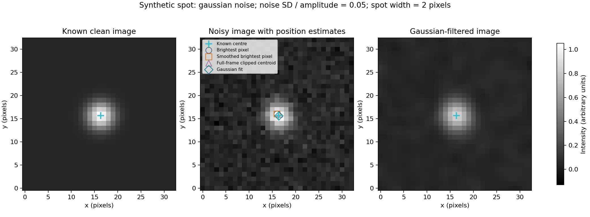
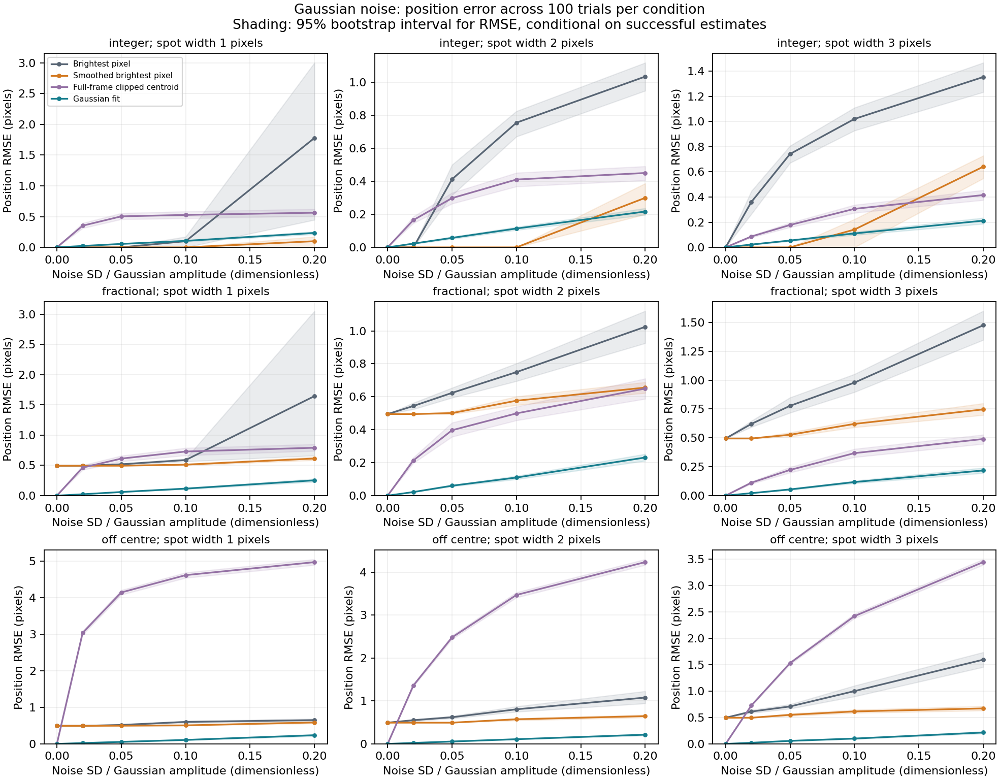
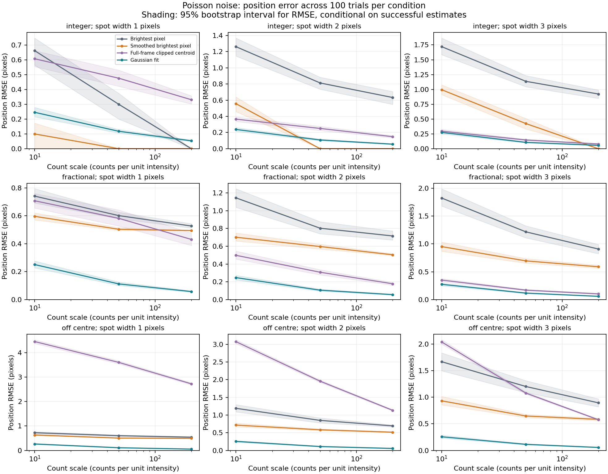
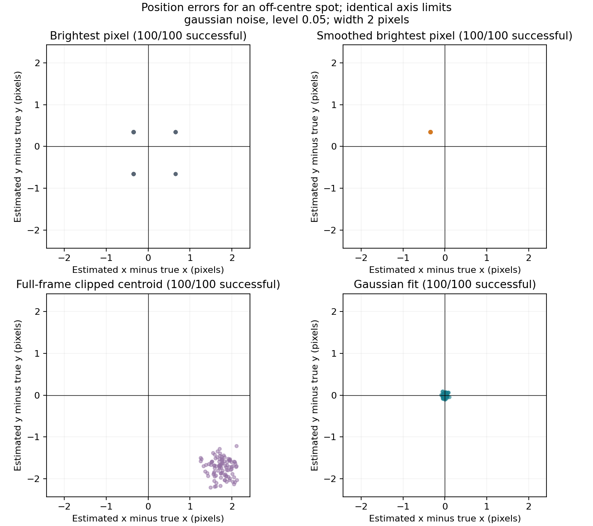

# Synthetic atom localisation: results

These results come from a simplified single-Gaussian image model. They do not establish accuracy on experimental electron microscopy images.

The experiment generated 7,200 noisy images and 28,800 method results. Each condition used 100 trials with root random seed 2027.

## What the images show

The example has a separate random stream and is not one of the statistical trials. All panels share an intensity scale. Filtering changes the image before a pixel maximum is selected; the Gaussian fit instead fits the raw image.

## Position error

For each successful measurement, dx = estimated x - true x and dy = estimated y - true y. The radial error is sqrt(dx² + dy²). RMSE is sqrt(mean(dx² + dy²)) across trials. Smaller is better. All distances are in pixels; no physical pixel size is assumed.

Shading is a percentile bootstrap 95% interval for each method's RMSE. It describes Monte Carlo sampling uncertainty under this model, not uncertainty in an individual atom position. Zero-noise trials are identical and can have a zero-width interval. The plots use successful estimates; failure rates must be read alongside the errors. A formal method comparison would bootstrap paired trial differences; the individual intervals alone do not establish a difference between methods.

## One preselected condition

Noise model: gaussian; noise level: 0.05; spot width: 2 pixels; true centre: (12.35, 19.65) pixels. This condition uses the middle entries of the configured width and noise lists, and the off-centre position. It was selected without reference to performance.

| Method | RMSE (pixels) | 95% bootstrap interval (pixels) | Bias vector (pixels) | Failures |
| --- | ---: | --- | --- | ---: |
| Brightest pixel | 0.6213 | 0.5941 to 0.6496 | (-0.1600, 0.0700) | 0/100 |
| Smoothed brightest pixel | 0.4950 | 0.4950 to 0.4950 | (-0.3500, 0.3500) | 0/100 |
| Full-frame clipped centroid | 2.4826 | 2.4424 to 2.5265 | (1.7522, -1.7329) | 0/100 |
| Gaussian fit | 0.0559 | 0.0506 to 0.0611 | (-0.0005, 0.0054) | 0/100 |

The cloud's displacement from the origin indicates bias. Its spread indicates variation between trials. All four panels have identical limits, so a tight cloud may be hard to resolve beside a much larger error. Read the numerical summary as well.

## Assumptions that affect the interpretation

- The signal is a circular Gaussian sampled at pixel centres, with one isolated spot and uniform background. Pixels are not area-integrated; there is no scan drift, probe asymmetry, neighbouring atom, detector response or beam damage.
- Gaussian noise is independent, additive and has standard deviation equal to the configured fraction of amplitude. Negative measured intensities are retained.
- Poisson noise, when requested, generates counts from clean intensity times count scale, then rescales them. A higher count scale reduces relative fluctuations. This is a counting exercise, not a calibrated electron-dose model.
- All methods receive exactly the same image in each trial. Only the centroid receives the true uniform background. The fitted centre, width, amplitude and background are estimated from data; the fit does not receive the true position or width.
- The full-frame centroid subtracts background and clips negative weights. Retained positive noise can pull it towards the frame centre. A local-window centroid may behave differently; these results do not rank all centroiding methods.
- Brightest-pixel methods return integer coordinates. Smoothing uses a fixed kernel of width 1 pixels and reflected boundaries. It does not remove pixel quantisation.
- The fit uses the same functional model that generated the signal. This favours the model-based estimator. Ordinary least squares also does not implement the appropriate Poisson likelihood. Model mismatch is an important next experiment.
- Optimiser non-convergence and active parameter bounds count as failures. Numerical convergence alone does not establish that a detected feature is an atom. There is no atom-detection confidence test in this project.
- Spot amplitude is held constant as width varies, so wider spots contain more total signal. This is not a comparison at fixed total counts.

## Inspect or reproduce

`trials.csv` records every method result; missing estimates remain as failure rows. `summary.csv` and `summary.json` contain per-condition statistics. `metadata.json` records parameters, versions, seed and Git state. See the project README for commands and `docs/explanation.md` for the mathematical walkthrough.
